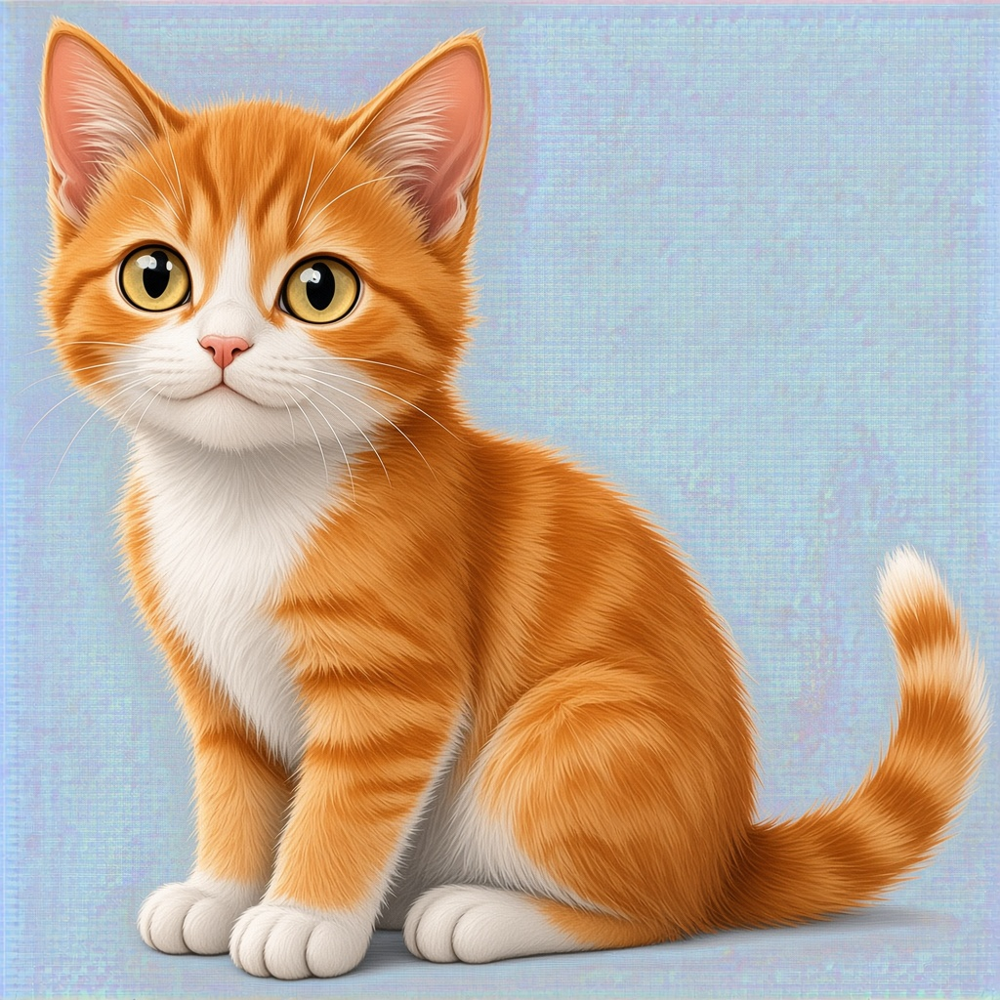
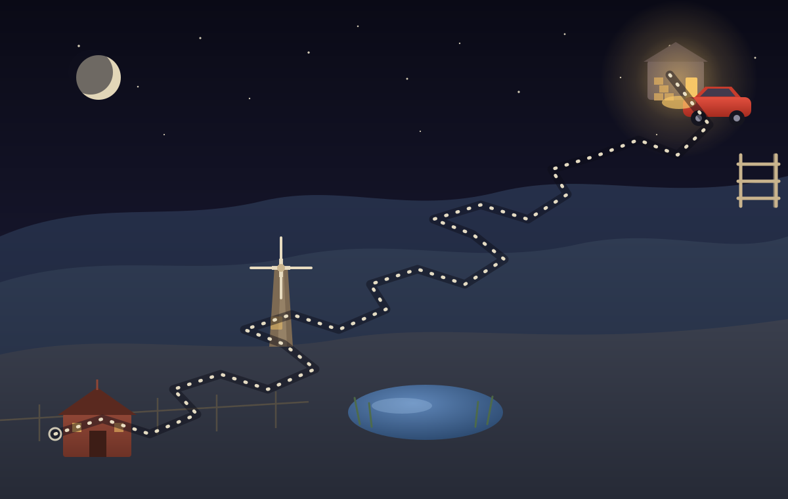

# CAT's Insurance Journey

A browser-based Property & Casualty learning adventure for Kansas, and a **harder sequel** to
[BAT's Insurance Adventure](https://github.com/BranamOps/BAT). CAT is a backyard alley cat from the
country who survived on human scraps and made it through every winter on what people left behind.
Other cats tested her along the way — not with claws, but with insurance knowledge. For a long time
her only goal was survival, until the day she saw the red car and decided she would leave with it.

**Play online:** <https://branamops.github.io/CAT/>

**Source repository:** <https://github.com/BranamOps/CAT>

## Meet CAT



CAT starts the journey young and grows up halfway through: master lesson 14 of 27 and the artwork
switches from `CAT_young.jpg` to `CAT_older.jpg` everywhere she appears.

## The journey map



## The rest of the cast

| Character | File | Where you meet them |
| --- | --- | --- |
| CAT (young) | `assets/CAT_young.jpg` | Levels 1–4, before the halfway point |
| CAT (older) | `assets/CAT_older.jpg` | Level 5 onward, and the repository page |
| The contestants | `assets/contestant-1.jpg`, `contestant-2.jpg`, `contestant-3.jpg` | Every lesson battle; one portrait turns up at random |
| SHADOW-1 | `assets/SHADOW-1.jpg` | The final exam |
| The mother | `assets/MOTHER.jpg` | The goal, on the front page, and the ending |

The goal is shown before you begin and again when you finish: the red car, the mother who drives it,
and the door CAT is learning to reach.

## How to play

1. Choose **Begin the journey**. The winding **Journey map** lives on its own screen — open it from the
   top navigation and tap Lesson 1 there whenever you prefer.
2. Read the short lesson, then choose **Start the 10-question lesson check**.
3. Choose an answer with the mouse, or press **1–4** and then **Enter**.
4. Every answer shows an explanation and the concept it tests.
5. Score at least **8 out of 10** to master a lesson and unlock the next stop. Anything less and the
   lesson waits for a retake.
6. Complete all **27 lessons**, then meet **SHADOW-1** for the final exam.

Press **Escape** at any time to leave a quiz and return to the lesson or the map. Your progress is
saved in this browser on this device.

## The journey

Nine levels, three lessons each — twenty-seven lessons in all, fifteen questions in every lesson's
bank with ten drawn per run. Question difficulty rises strictly with the level. Each land is guarded
by a rival who may turn up for **ATTACK TIME** when a question's clock runs out.

| Level | Title | Rival | ATTACK TIME chance |
| --- | --- | --- | --- |
| 1 | The Cold Alley | The Alley Tom | 10% |
| 2 | The Warm Doorstep | The Porch Cat | 20% |
| 3 | The Garden Path | The Garden Tabby | 30% |
| 4 | The Sunny Wall | The Wall Cat | 40% |
| 5 | The Rooftop Run | The Rooftop Tom | 50% |
| 6 | The Outer Yards | The Yard Cat | 60% |
| 7 | The Night Watch | The Night Cat | 70% |
| 8 | The Highway Verge | The Highway Cat | 80% |
| 9 | The Long Shadow | SHADOW CAT | 90% |

## How a lesson runs

1. **Study** the lesson, its three teaching sections, its scenario, and the ideas it covers.
2. **Answer ten questions.** Each lesson's bank holds fifteen, and a run draws ten of them, so a
   retake deals a different hand. Every answer immediately shows a teaching explanation and the
   concept being tested.
3. **Beat the clock.** The lesson has a **10-minute** timer and each question has a **60-second** timer.
4. **Survive ATTACK TIME.** If a question's 60 seconds expire, the question scores as incorrect and
   the rival may call **ATTACK TIME**, subtracting a random **0–60 seconds** from the lesson clock.
   The chance rises from **10% at Level 1 to 90% at Level 9** (10 points per level). A contestant also
   drops in at most **once per question**, and while it is on screen both clocks run **three times as
   fast**.
5. **Pass or retake.** A lesson needs **80%** (8 of 10). Anything less keeps the lesson locked with a
   **retake** available — retakes reshuffle the question order and reset both clocks.

## The final exam

After all twenty-seven lessons, the only attacker left is **SHADOW-1**: her own shadow.

- **156 questions**, drawn from all twenty-seven lessons (5–6 from each).
- **150 minutes** for the whole exam, with a single total clock.
- **No ATTACK TIME** — the shadow never touches the clock.
- **80% to pass.**

Afterward the game reports the score and grade, a **weak-area breakdown by level**, links back to the
lessons that need review, and a **full answer review of all 156 questions** with explanations. The
exam review is **saved to the browser**, so it survives a reload — reopen it from the map with
**Review last exam**.

## Run locally for testing

Serve the folder over HTTP — the game fetches its lesson and question data, so opening `index.html`
over `file://` will not work:

```bash
python3 -m http.server 4174
```

Then open <http://localhost:4174/>. A tester password (`please`) unlocks every level so the timers
and the exam can be checked; it is a testing convenience, not access control.

## Project files

- `index.html`, `app.css`, `app.js` — page shell, night-alley theme, and game behavior.
- `data/curriculum.json` — the nine levels, twenty-seven lessons, teaching text, timer configuration,
  the ATTACK TIME curve, and the exam blueprint.
- `data/questions.json` — the 405-question bank (fifteen per lesson, with three to five drawn from
  the Kansas laws and insurance material in each lesson).
- `assets/world.svg` — the illustrated journey map (a winding trail to the red car).
- `assets/CAT_young.jpg`, `assets/CAT_older.jpg`, `assets/contestant-1.jpg`, `assets/contestant-2.jpg`,
  `assets/contestant-3.jpg`, `assets/SHADOW-1.jpg`, `assets/MOTHER.jpg` — character and ending art.
- `tools/` — the authoring and verification scripts (development only; not needed to play).
- `.github/workflows/static.yml` — deploys the repository to GitHub Pages on every push to `main`.

The game is plain HTML, CSS, and JavaScript: no framework, no build step, no dependencies, no backend.

## Rebuilding the question bank

The questions are authored as compact data and assembled into JSON, which keeps the answer key
balanced and consistent:

```bash
python3 tools/build.py          # rebuild data/*.json and validate the bank
```

`build.py` refuses to write output unless the bank passes its checks: nine levels, three lessons per
level, fifteen questions per lesson, four distinct options, a valid answer index, a non-empty
explanation, a topic label on every question, an answer key within 15–35% per position, and an average
question difficulty that rises strictly from level to level. It also requires three to five of every
lesson's questions to carry the Kansas source tag, and rejects any content that names a source document.

Each question may carry an optional eighth element, `"kansas"`, marking an idea taken from the Kansas
laws and insurance material; every other question is treated as `"manual"`. The tag is authoring
metadata only and is stripped before the bank ships, so the game itself never cites a source.

## Verification

```bash
# data + headless DOM behavior
JSDOM_PATH=/path/to/jsdom node tools/verify.cjs

# real-browser layout, mobile viewport, timers, ATTACK TIME
PLAYWRIGHT_PATH=/path/to/playwright node tools/browser-check.cjs
```

`verify.cjs` drives the actual app in a headless DOM: it validates the bank (405 questions, fifteen
per lesson), then runs lessons, lets the question clock expire, forces and suppresses ATTACK TIME,
checks that an attack subtracts exactly the stolen seconds, runs a lesson to a passing and a failing
score, exercises the retake path, tests the keyboard shortcuts, confirms the CAT young/older switch
and the contestant portraits, verifies the contestant turns up at most once per question and triples
both clocks while it is on screen, checks that the exam review persists across a reload, and runs the
156-question exam to both a passing and a failing result.

`browser-check.cjs` runs the same app in headless Chromium at a 390×844 phone viewport and a
1366×900 desktop viewport, checking for console errors, horizontal overflow, tap-target size, live
countdown behavior, keyboard play, and screenshots of the landing page, map, quiz, ATTACK TIME
banner, results and exam.

## Publishing

The repository has no dependencies and no build step: it is plain HTML, CSS, and JavaScript. It runs
from a static server and publishes to GitHub Pages through `.github/workflows/static.yml` on every
push to `main`. Because the whole game is static, any static host works — Netlify, Cloudflare Pages,
Vercel, or an internal web server.
